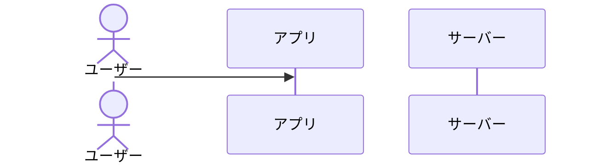

# Structure 設計書

<!-- STEP 02-3。strategy.md と scope.md を前提に、情報構造と遷移の流れを決める -->

## 前提

- strategy.md / scope.md

## 情報構造

(画面・データのまとまりと階層。例の形: 一覧 > 絞り込み > 詳細)

## 画面一覧と遷移

(画面名と、どこからどこへ遷移するか)

## 主要インタラクションフロー

<!-- 主要なユースケースごとに、ユーザー・クライアント・サーバー・外部サービスの間のやり取りを
     シーケンス図(Mermaid 等)で書く -->

### 1. (フロー名)

## 状態と例外

(空の状態・読み込み中・エラー・上限到達・未ログイン など)
